<a href="https://meellinaa.github.io/"></a>




<a href="https://github.com/Meellinaa/StemSlice"></a><a href="https://github.com/Meellinaa/omniprep-ai"></a>

<a href="https://github.com/Meellinaa/TheGrindTracker"></a><a href="https://github.com/Meellinaa/ai-beauty-consultant"></a>

<a href="https://github.com/Meellinaa/llm-robustness-tester"></a><a href="https://github.com/Meellinaa/SpendPal"></a>



<a href="https://meellinaa.github.io/"></a>

  
  
  

